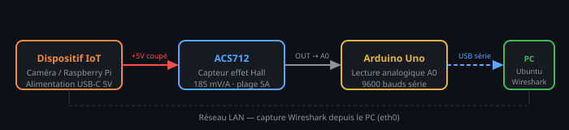
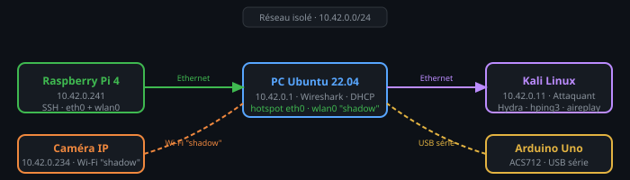
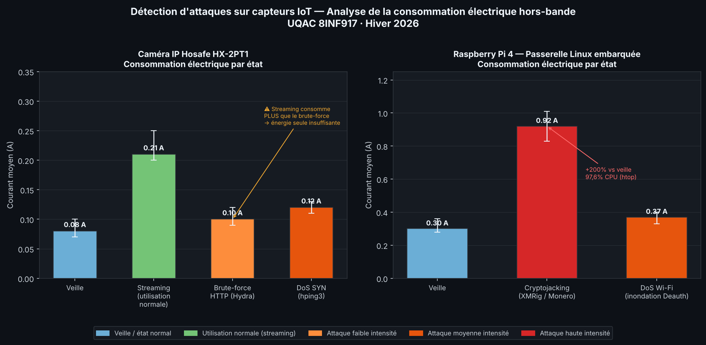

# Détection d'attaques sur capteurs IoT - Analyse énergétique et trafic réseau
---

## Le problème

Les bâtiments intelligents utilisent des dizaines de capteurs IoT connectés en permanence : caméras IP, capteurs de température, passerelles Linux embarquées. Ces dispositifs sont rarement surveillés pour détecter des intrusions ou des comportements anormaux. La raison principale : **on ne peut pas installer un agent de sécurité classique dessus**,   ils sont trop limités en ressources, tournent sur des firmwares propriétaires, et sont souvent oubliés une fois déployés.

**Question de recherche : peut-on détecter une cyberattaque sur un capteur IoT sans jamais toucher au dispositif lui-même ?**

---

## Notre approche

Plutôt que d'analyser ce qui se passe *à l'intérieur* du dispositif, nous avons mesuré deux signaux *depuis l'extérieur*, hors-bande :

| Signal | Comment | Depuis où |
|--------|---------|-----------|
| **Consommation électrique** | Capteur de courant ACS712 inséré en série sur le câble d'alimentation | Arduino Uno → PC |
| **Trafic réseau** | Capture Wireshark sur l'interface réseau de la passerelle | PC de surveillance |

L'idée : une attaque modifie le comportement du dispositif — ce changement laisse une empreinte mesurable dans sa consommation électrique **et** dans les flux réseau qu'il génère. Ces deux signaux sont observables depuis l'infrastructure, sans rien modifier sur le dispositif ciblé.

---

## Montage matériel



Le câble d'alimentation USB-C de chaque dispositif IoT est coupé et le capteur ACS712 est inséré **en série sur le fil positif (+5V)**. L'Arduino lit le courant en continu et l'envoie via port série USB au PC de surveillance, pendant que Wireshark capture le trafic réseau sur le même segment.

> 📐 Guide complet de câblage et calibration : [`docs/hardware_setup.md`](docs/hardware_setup.md)

**Matériel utilisé :**

| Composant | Modèle | Rôle |
|-----------|--------|------|
| Microcontrôleur | Arduino Uno (ATmega328P) | Acquisition du courant |
| Capteur de courant | ACS712 5A | Mesure hors-bande (effet Hall) |
| Capteur IoT 1 | Caméra IP Hosafe HX-2PT1 | Cible principale |
| Capteur IoT 2 | Raspberry Pi 4 (Debian Bookworm) | Cible secondaire |
| Attaquant | Kali Linux | Hydra · hping3 · XMRig · aireplay-ng |
| Surveillance | PC Ubuntu 22.04 | Wireshark · Arduino IDE 2.3.7 |

---

## Infrastructure réseau du laboratoire



Le réseau de laboratoire a été monté et configuré manuellement pour reproduire un environnement IoT typique : tous les dispositifs sur le même segment réseau, isolé d'Internet, avec le PC de surveillance positionné comme passerelle — ce qui lui permet de voir **tout le trafic** du segment via Wireshark.

> 📋 Topologie détaillée, plan IP et commandes de configuration : [`config/lab_network.md`](config/lab_network.md)  
> 🖥️ Configuration OS du Raspberry Pi (Bookworm, SSH, services) : [`config/raspberry_pi_setup.md`](config/raspberry_pi_setup.md)

---

## Méthodologie expérimentale

Pour chaque scénario, nous avons suivi le même protocole :

1. **Ligne de base** - 2 min de stabilisation, puis 300 lectures de courant (~5 min)
2. **Lancement de l'attaque** - depuis Kali Linux, sur la cible choisie
3. **Mesure sous attaque** - 300 nouvelles lectures pendant que l'attaque est active
4. **Capture réseau simultanée** - Wireshark sur `eth0` pendant toute la durée
5. **Retour à la normale** - vérification que la consommation revient à la ligne de base

Quatre attaques ont été testées :

| Attaque | Outil | Cible | Type |
|---------|-------|-------|------|
| Brute-force HTTP | Hydra v9.6 | Caméra IP (port 80) | Authentification |
| DoS par inondation SYN | hping3 | Caméra IP (port 80) | Déni de service |
| Cryptojacking (minage XMR) | XMRig (ARM) | Raspberry Pi | Post-exploitation |
| DoS Wi-Fi | aireplay-ng | Raspberry Pi (wlan0) | 802.11 deauth |

---

## Résultats

### Graphique de consommation électrique



### Ce qu'on a mesuré

#### Caméra IP Hosafe HX-2PT1

| État | Courant moy. | Courant max | Observation |
|------|-------------|-------------|-------------|
| Veille | ~0,08 A | ~0,10 A | Keepalive Wi-Fi uniquement |
| Streaming normal | ~0,21 A | ~0,25 A | +160% vs veille — encodage vidéo actif |
| Brute-force HTTP (Hydra) | ~0,10 A | ~0,12 A | +20% vs veille — CPU traite les requêtes |
| DoS SYN (hping3) | ~0,12 A | ~0,13 A | +30% vs veille — pile réseau saturée |

**Brute-force :**
```bash
crunch 4 9 abc123 -c 500 -o dictionnaire.txt
hydra -l admin -P dictionnaire.txt -t 1 -W 2 192.168.2.39 http-get /
# Résultat : mot de passe "admin12345" trouvé — aucun verrouillage de compte
```

**DoS :**
```bash
hping3 192.168.137.41 -S -p 80 -i u1000
# Résultat : 80 073 paquets envoyés — flux vidéo gelé, interface admin inaccessible
```

#### Raspberry Pi 4

| Attaque | Signature électrique | Signature réseau |
|---------|---------------------|-----------------|
| Cryptojacking (XMRig) | +200% vs veille - 97,6% CPU soutenu | Connexions sortantes persistantes vers pool de minage |
| DoS Wi-Fi (deauth) | Légère hausse - tentatives de reconnexion | Trames association/désassociation répétées |

**Cryptojacking :**
```bash
# Après brute-force SSH (mot de passe "pi:123456")
# XMRig compilé ARM déployé sur le Pi, déguisé en "system_update_daemon" (systemd)
# Minage XMR silencieux en arrière-plan — 100% CPU tous les cœurs
```

---

## Conclusions

**1. L'énergie seule ne suffit pas pour la caméra**

Le streaming normal consomme *plus* que le brute-force (0,21 A vs 0,10 A). Un système de détection basé uniquement sur la consommation électrique produirait des **faux négatifs** pour les caméras IP — point critique pour les déploiements PoE en bâtiment intelligent.

**2. L'analyse réseau est le signal le plus fiable**

Wireshark distingue sans ambiguïté les patterns d'attaque du trafic normal :
- Brute-force : avalanche de requêtes `GET / HTTP/1.1` avec `Authorization: Basic` encodé en Base64 — identifiants en clair, aucun HTTPS
- DoS : tempête de paquets SYN, alertes "TCP Port numbers reused", table de connexions saturée

**3. La corrélation des deux signaux est l'approche optimale**

Anomalie réseau **+** pic énergétique corrélé → haute confiance, peu de faux positifs. Cette approche double-signal est déployable sur n'importe quelle infrastructure IoT PoE sans agent sur l'endpoint, depuis un switch avec port SPAN sur le VLAN de surveillance.

**4. Failles de sécurité identifiées sur les dispositifs testés**

- Authentification HTTP en clair (Base64 non chiffré) sur la caméra
- Aucun mécanisme de verrouillage de compte sur l'interface admin
- Mot de passe SSH trivial (`pi:123456`) — compromission en quelques secondes avec Hydra
- Interface Wi-Fi sans PMF (802.11w) — vulnérable aux trames deauth

---

## Sketch Arduino - Mesure de courant

```cpp
float BIAS = 0.007;  // Décalage de calibration mesuré empiriquement (volts)

void setup() {
  Serial.begin(9600);
}

void loop() {
  long echantillons = 0;
  for (int i = 0; i < 300; i++) {
    echantillons += analogRead(A0);
    delay(3);
  }
  float tension = (echantillons / 300.0) * (5.0 / 1023.0);
  float courant = -(tension - 2.5 - BIAS) / 0.185;  // Sensibilité ACS712 : 185 mV/A
  Serial.println(abs(courant));
}
```

Les 300 échantillons moyennés donnent une lecture stable (~1 lecture/seconde) résistante au bruit électrique.

---

## Outils utilisés

| Outil | Version | Usage |
|-------|---------|-------|
| Arduino IDE | 2.3.7 | Téléversement sketch + Serial Plotter |
| Wireshark | — | Capture et analyse réseau |
| Hydra | v9.6 | Brute-force HTTP et SSH |
| hping3 | — | DoS par inondation SYN |
| Crunch | — | Génération de dictionnaire |
| XMRig | — | Simulation de cryptojacking (ARM) |
| aireplay-ng | — | DoS Wi-Fi (inondation deauth) |
| Kali Linux | — | Plateforme d'attaque |

---

## Structure du dépôt

```
iot-attack-detection/
├── arduino/
│   └── current_sensor.ino         # Sketch Arduino — acquisition ACS712
├── scripts/
│   ├── serial_logger.py           # Journalisation port série → CSV
│   ├── traffic_analyzer.py        # Détection de patterns d'attaque dans .pcap
│   └── plot_energy.py             # Génération du graphique comparatif
├── config/                        # ← Configuration matérielle, réseau et OS
│   ├── lab_network.md             # Topologie réseau, plan IP, hotspot, Wi-Fi "shadow"
│   └── raspberry_pi_setup.md      # OS Debian Bookworm, SSH, services, IoC
├── data/
│   ├── measurements_summary.csv   # Résultats agrégés (tous les scénarios)
│   ├── energy_camera.csv          # Lectures brutes — caméra IP
│   └── energy_pi.csv              # Lectures brutes — Raspberry Pi
├── docs/
│   ├── hardware_setup.md          # Guide de câblage ACS712 + calibration
│   ├── hardware_overview.svg      # Schéma matériel simplifié
│   ├── network_overview.svg       # Schéma réseau simplifié
│   ├── network_topology.svg       # Topologie réseau complète
│   ├── acs712_wiring.svg          # Câblage ACS712 détaillé
│   ├── attack_signatures.md       # Référence : attaque → signature énergie + réseau
│   └── energy_comparison.png      # Graphique de consommation par scénario
├── captures/
│   └── README.md                  # Inventaire des captures + filtres Wireshark
└── README.md
```

---
## Contexte académique
Ce projet a été réalisé dans un environnement expérimental isolé - réseau privé, aucun dispositif exposé sur Internet. Toutes les attaques ont été conduites à des fins de recherche uniquement.

---

## Références

- Fiche technique ACS712 - Allegro MicroSystems https://www.allegromicro.com/~/media/files/datasheets/acs712-datasheet.ashx
- Getting started with Raspberry Pi - https://projects.raspberrypi.org/en/projects/raspberry-pi-getting-started
- Using Python and an Arduino to Read a Sensor - https://pythonforundergradengineers.com/python-arduino-potentiometer.html#connect-the-arduino-to-the-computer-and-check-the-com-port
- Documentation Wireshark - https://www.wireshark.org/docs/