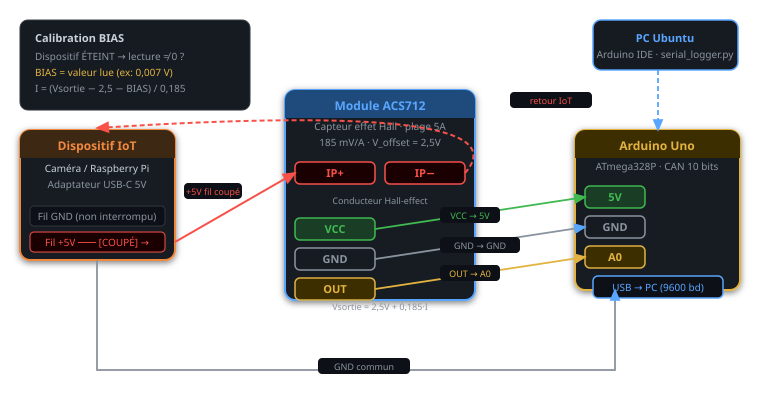

# Montage matériel — Câblage du capteur de courant ACS712

> Guide de montage détaillé pour le dispositif de surveillance énergétique hors-bande
> utilisé lors des expériences du laboratoire UQAC 8INF917.

---

## Liste du matériel

| Composant | Modèle | Spécification |
|-----------|--------|---------------|
| Microcontrôleur | Arduino Uno | ATmega328P, 5V, CAN 10 bits |
| Capteur de courant | Module ACS712 | Plage 5A, sensibilité 185 mV/A |
| Caméra IP | Hosafe HX-2PT1 | Alimentation USB-C 5V/2A |
| Nano-ordinateur | Raspberry Pi 4 | Alimentation USB-C 5V/3A |
| PC de surveillance | Ubuntu 22.04 | Arduino IDE 2.3.7, Wireshark |
| Machine attaquante | Kali Linux | Hydra, hping3, aireplay-ng |

---

## Capteur ACS712 — Principe de fonctionnement

L'ACS712 est un capteur de courant à effet Hall. Il produit une tension proportionnelle
au courant traversant son conducteur :

```
Vsortie = Vcc/2 + (Sensibilité × I)
        = 2,5 V  + (0,185 V/A × I)    ← pour le module 5A

En réarrangeant :
  I = (Vsortie - 2,5 - BIAS) / 0,185
```

L'Arduino lit Vsortie sur la broche analogique A0 (0–1023 pas CAN pour 0–5V) :
```
Vsortie = lecture_CAN × (5,0 / 1023,0)
```

**BIAS = 0,007 V** a été mesuré empiriquement avec le dispositif ÉTEINT
(aucun courant ne circule), pour compenser le décalage continu du capteur.

---

## Schéma de câblage



**Procédure de montage pas à pas :**

1. Couper le **fil positif** (+5V) du câble d'alimentation USB-C du dispositif IoT
2. Insérer le module ACS712 **en série** : extrémité dénudée côté alimentation → borne IP+,
   autre extrémité dénudée côté dispositif → borne IP–
3. Connecter l'alimentation du module ACS712 : VCC → 5V Arduino, GND → GND Arduino
4. Connecter la sortie ACS712 : OUT → A0 Arduino
5. Connecter l'Arduino au PC via USB
6. Téléverser `arduino/current_sensor.ino`
7. Ouvrir le Moniteur Série à **9600 bauds** pour vérifier les lectures

> ⚠️ Sécurité : intervenir uniquement sur des circuits **basse tension (5V USB)**.
> S'assurer que l'Arduino et le PC partagent la même masse GND que le dispositif surveillé.

---

## Procédure de calibration

Avant d'enregistrer des mesures, vérifier la valeur BIAS :

1. Débrancher le dispositif IoT (aucun courant ne traverse l'ACS712)
2. Ouvrir le Moniteur Série — observer les lectures
3. Lecture idéale sans courant : **0,000 A**
4. Si on lit par exemple `0,007 A`, régler `BIAS = 0,007` dans le sketch
5. Re-téléverser et vérifier que les lectures reviennent à ~0,000 A sans courant

Plage typique de BIAS : 0,005 – 0,015 V selon le module individuel.

---

## Protocole de mesure utilisé dans cette étude

Pour chaque scénario d'attaque, nous avons :

1. Laissé le dispositif atteindre l'**état stable** pendant 2 minutes avant l'enregistrement
2. Capturé **300 lectures série** (≈ 5 minutes à ~1 lecture/s)
3. Calculé min, moy, max et écart-type par scénario
4. Lancé les attaques **après** la capture de la ligne de base
5. Capturé 300 lectures supplémentaires pendant que l'attaque était active
6. Arrêté l'attaque et vérifié le retour à la consommation de base
